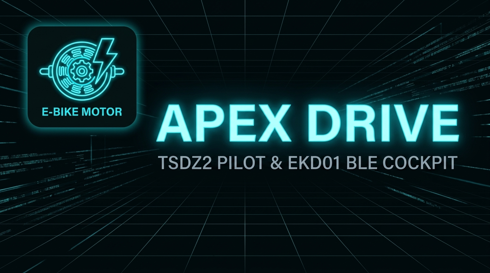

# APEX DRIVE

**APEX DRIVE** is the ultimate Android companion application for e-bikes powered by the Tongsheng TSDZ2 Mid-Drive Motor and Varstrom EKD01 display.

Designed with a sleek, cyberpunk-inspired Obsidian dashboard, APEX DRIVE completely replaces the need for the official app, offering direct Bluetooth control, smart autonomous riding features, and transparent telemetry. Values that are not exposed by the EKD01 BLE protocol are clearly treated as estimates, not as direct sensor readings.

---

## ☕ Support the Project

APEX DRIVE is provided **free of charge** (Freeware) for the e-bike community. There are no paywalls, in-app purchases, subscriptions, or ads.

If you enjoy the app and want to support ongoing development, optimizations, and new features, tips and donations are greatly appreciated!

| Platform | Link | Description |
| :--- | :--- | :--- |
| ☕ **Ko-fi** |  | Send a one-time tip or buy a coffee via [ko-fi.com/j4ckp0t85](https://ko-fi.com/j4ckp0t85) |
| 💳 **PayPal** |  | Direct donation via [PayPal (EUR)](https://www.paypal.com/donate/?business=ZDARGHTS7LUDA&no_recurring=1&currency_code=EUR) |

---

## ⚠️ Important Notes & Firmware Requirements

Before using APEX DRIVE, please carefully review the following requirements and operational notes:

1. **Designed Exclusively for emmebrusa OSF Firmware**: 
   APEX DRIVE is specifically engineered as an extension for the [emmebrusa Open Source Firmware (OSF)](https://github.com/emmebrusa/TSDZ2-Smart-EBike-1). The app relies on custom commands and protocol behavior unique to this modified firmware. **Using APEX DRIVE with stock TSDZ2 firmware or with this display paired to any other motor model is essentially useless.**

2. **BLE & Firmware Telemetry Limitations**: 
   Due to hardware and protocol boundaries on current OSF over Bluetooth Low Energy:
   * **Speed, battery %, assist level and light state are read from EKD01 BLE telemetry.**
   * **Motor Watts, Rider Watts, Cadence RPM and Motor/Controller Temperature are estimates/derived values in the current release.** The TSDZ2 motor firmware sends real battery power to the EKD01 display over UART, but the current Android BLE parser has not yet verified a stable BLE field that exposes that value without altering the speed field.
   * **Cadence RPM is an estimation** unless a future verified BLE field or external cadence sensor is integrated.
   * **Thermal values are not hardware temperature readings** on firmware profiles where the TSDZ2 temperature sensor path is disabled; they are computed indicators for UI continuity and should not be used as the only thermal-protection source.
   * **Startup Assist Program Identification**: The app cannot read which assist program is active upon motor boot. Therefore, **Auto Assist must NOT be enabled if your default startup program is CRUISE MODE**. Auto Assist should only be used after deploying a known assist program directly from the app.

3. **Stationary Execution Only**: 
   Changing assist programs or sending macro configuration commands is **only permitted when the bike is stationary (0 km/h)** to ensure safety and proper state synchronization.

4. **Startup & Program Switching Delay**: 
   As recommended by emmebrusa, always **wait a few seconds** after turning on the motor or after deploying a new assist program before you start riding/pedaling. To prevent the OSF firmware's diagnostic display values from being interpreted as BLE speed, configure the firmware with **Auto display data with lights on disabled**, **Number of data displayed at lights on set to 0**, and **Data display on startup disabled/None (0)**. The first two settings prevent the automatic diagnostic cycle triggered by the light-button sequence used when applying programs; the startup setting is separate and is required to suppress the boot-time diagnostic value. Setting the number of displayed data to 0 alone is not sufficient on all OSF builds. These settings do not disable manual parameter or sensor-calibration screens, so APEX DRIVE must still treat incoming telemetry as untrusted during firmware transitions.

5. **Smartphone Mount & Pitch Sensor Calibration**: 
   Since **Auto Assist** relies on smartphone sensors (accelerometer, gyroscope, barometric sensor) for slope and incline detection:
   * The smartphone **must be securely fixed to a handlebar phone mount** while riding.
   * Before using Auto Assist, perform a **pitch sensor calibration in the Settings tab while stationary on level ground (0° slope)** to ensure accurate slope readings and correct pilot behavior.

---

## ⚡ Key Features

### 🤖 Smart "AUTO" Assist Pilot
Say goodbye to constantly adjusting your assist levels. APEX DRIVE's intelligent Auto-Pilot continuously monitors your environment and riding style to seamlessly shift gears for you:
* **Slope & Incline Sensing**: Detects hills in real-time using Barometric and Pitch sensor fusion, automatically ramping up power when you climb and saving battery on descents.
* **Cadence Strain Recovery**: Senses when you're grinding at a low cadence on a steep hill and provides an instant torque boost.
* **Adaptive Presets**: Choose your riding style—from **ECO PRO** (maximizing range) to **BALANCED** (everyday commutes), **DYNAMIC eMTB** (aggressive torque for trail riding), or **HAMMER** (maximum power performance with Level 3 base and automatic thermal degradation).
* **Configurable Decision Reactivity**: Choose between two physical response behaviors directly in Settings:
  * **⚡ FAST / REACTIVE (Default)**: Engineered for instantaneous ramp and climb assistance
  * **🛡️ SMOOTH / RELAXED**: Engineered for steady, relaxed cruising with maximum bump and vibration suppression
* **Battery Guardian & Thermal Protection**: Automatically dials back power if your battery is critically low (≤15%) or if the motor temperature gets too hot (≥60°C, auto-degrading HAMMER mode to ECO CONSERVATIVE).

### 📈 Professional Telemetry & Crash-Proof Logging
Turn your smartphone into a high-performance bike computer.
* **Live Cockpit**: A beautiful 60fps hardware-accelerated dashboard displaying measured EKD01 telemetry together with modeled Motor Watts, Rider Watts, Cadence RPM, Battery %, and Motor/Controller Temperature indicators.
* **Disk-Streaming Logger**: Every second of your ride is logged into a CSV file. The system is 100% crash-proof—if your phone dies, zero data is lost.
* **Post-Ride Analytics**: Export your ride data to view modeled motor/rider power trends, thermal indicators, and battery discharge curves.

### USB telemetry publishing

> **Current release limitation: [ApexTelemetry](https://github.com/j4ckp0t85/apex-telemetry) direct phone synchronization is supported on Windows only.**

Completed connection sessions are copied automatically to `Download/ApexDrive/Telemetry/` on the phone. The CSV and its `.ready.json` manifest are written and verified before they become visible over USB. A failed copy remains retryable and never removes the private recording.

To sync from ApexTelemetry on Windows:

1. Unlock the phone and choose **File transfer / Android Auto** from the USB notification.
2. Do not use **Photo transfer (PTP)**. If Windows shows only `DCIM` and `Pictures`, switch USB mode; those folders do not expose telemetry files.
3. If Device Manager shows an **MTP device** with a yellow question mark, install the driver manually: **Update driver** → **Browse my computer for drivers** → **Let me pick from a list of available drivers** → **Portable Devices** → **MTP USB Device**.
4. Keep the phone unlocked while Electron finds the phone and starts synchronization. USB debugging and ADB are not required.

The Electron sync is Windows-only in the current release because it uses the Windows Portable Devices (WPD) API. macOS and Linux support is technically possible, but requires separate native MTP adapters exposing device discovery, folder enumeration, streamed read, cancellation, timeout, and disconnect handling. It would also require per-platform binaries, architecture-specific packaging, permissions/driver setup, and physical-device validation. The Android publisher itself is platform-independent.

### 🎛️ Live OSF Configuration & Macro Engine
Take full control over the Open Source Firmware (OSF) directly from your screen.
* **OSF Program Automation**: Switch between 15 built-in modes (e.g., Street/Off-Road Mode, Cruise Mode, eMTB Assist) with a single tap. APEX DRIVE automatically handles the complex sequence of button presses on the display for you.
* **Dynamic .INI Profile Import**: It is highly important to import your specific motor profile (`.ini` file). This file is derived directly from the Java Configurator of the [emmebrusa OSF](https://github.com/emmebrusa/TSDZ2-Smart-EBike-1). Importing it calibrates road-load physics, assist ratios, battery limits, and range estimation. It improves the modeled Watts shown on the phone, but does not turn estimated values into direct controller measurements.

### 📱 Uninterrupted Background Execution
Keep your phone in your pocket. APEX DRIVE uses advanced foreground services and wake locks to maintain a rock-solid BLE connection and continuous Auto-Pilot operation even when your screen is locked. A persistent lock-screen notification keeps you updated on your speed, current slope, and active assist level.

## 📡 Telemetry: Measurements vs Estimates

APEX DRIVE receives its live data through the EKD01 display BLE protocol. In the current verified parser, speed, battery percentage, assist level and light state are read from BLE notifications. Motor Watts, Rider Watts, Cadence RPM, battery voltage/current and temperature values are derived by the app from speed, acceleration, battery %, the imported OSF `.ini` profile and the selected assist level.

The TSDZ2 motor controller firmware already sends battery electrical power to the EKD01 over its internal UART link in 10 W units. A future release may be able to decode that same value from BLE if a real notification field is confirmed by passive capture. Until then, APEX DRIVE does not multiplex telemetry through the speed field, because that can cause display flicker and incorrect distance accounting.

These modeled values are useful for ride trends, Auto Assist decisions and post-ride analysis, but they should be read as transparent estimates unless the UI explicitly marks them as hardware-measured.
---

## 🚀 Getting Started

1. **Download APK**: Download the latest official `.apk` release from the repository's **Releases** tab.
2. **Mount Your Phone**: Secure your Android device to your handlebars.
3. **Grant Permissions**: Ensure Location, Bluetooth, and Battery Unrestricted permissions are enabled.
4. **Connect via Bluetooth**: Launch APEX DRIVE and tap the radar scan button to instantly connect to your EKD01 display.
5. **Calibrate**: For the best Auto-Pilot experience, calibrate the pitch sensor while parked on a flat surface in the Settings tab.
6. **Ride**: Tap the 🤖 AUTO button, start pedaling, and let APEX DRIVE handle the rest!

---

## 🔒 Required Permissions & System Setup

For APEX DRIVE to function reliably—especially when riding with your phone locked or in a pocket—the following permissions and battery settings must be configured:

* **Nearby Devices / Bluetooth & Location (Precise Location)**:
  * **Why it is needed**: Android requires Location services enabled to scan for nearby Bluetooth Low Energy (BLE) devices. APEX DRIVE also uses GPS for slope cross-validation and sensor auto-calibration.
  * **Setup**: Grant **"Precise Location"** permission and ensure your phone's GPS is enabled.

* **Battery Optimization (Set to "Unrestricted")**:
  * **Why it is needed**: Aggressive Android battery-saving policies (Doze mode) will suspend background Bluetooth communication and stop the Auto-Pilot engine when the screen turns off.
  * **Setup**: Open your phone's *App Info* for APEX DRIVE $\rightarrow$ *Battery* $\rightarrow$ select **"Unrestricted"** (or turn off battery optimizations).
  * *Manufacturer Tips*:
    * **Samsung (One UI)**: Set Battery to *Unrestricted* and ensure the app is excluded from *Sleeping apps*.
    * **Xiaomi / Redmi / POCO (MIUI / HyperOS)**: Enable *Autostart* and set Battery Saver to *No restrictions*.
    * **Huawei / Honor**: Set App Launch to *Manage manually* (enable *Auto-launch* and *Run in background*).
    * **OPPO / Realme / OnePlus**: Enable *Allow background activity* and *Auto-launch*.

* **Notifications**:
  * **Why it is needed**: On Android 13+, notification permission is required to display the persistent lock-screen HUD (live speed, assist level, and gradient) and maintain continuous foreground execution.

---

## 🛡️ Privacy & Zero Data Collection

APEX DRIVE operates strictly under a **100% Offline, Zero-Collection Privacy Model**:
* **No Telemetry or Remote Servers**: The app does **not** include the `INTERNET` permission in its Android Manifest. It is technically impossible for the application to transmit data over the network or track users.
* **Local Storage Only**: All ride logs (CSV files) and custom profiles are stored exclusively on your phone's local private storage and are never uploaded or shared.
* For complete details on GDPR / CCPA compliance and permission usage, read our full [Privacy Policy](PRIVACY.md).

---

## 🇪🇺 EU AI Act & Artificial Intelligence Transparency

In compliance with **Regulation (EU) 2024/1689 (European Union AI Act)**:
* **AI-Assisted Development**: Portions of the codebase, documentation, and technical optimizations for APEX DRIVE were developed with the assistance of Generative AI tools and LLMs under rigorous human oversight, validation, and architectural review.
* **Deterministic Assist Logic**: The in-app "Smart AUTO Assist Pilot" is a **rule-based, deterministic sensor-fusion algorithm** (evaluating pitch, cadence, pressure, and battery thresholds) and does **not** use autonomous deep-learning models or high-risk decision systems.
* For the full compliance declaration and risk assessment, see [AI_DISCLOSURE.md](AI_DISCLOSURE.md).

---

## ⚖️ Legal Disclaimer & Limitation of Liability

* **Road Safety & Distraction**: **Never operate or look at the phone screen while riding.** Interacting with mobile devices in motion is dangerous. The rider bears 100% responsibility for observing all local road traffic laws, speed limits (e.g. 25 km/h EU / 20 mph US), and safety helmet regulations.
* **Hardware & Motor Safety**: APEX DRIVE interfaces with third-party open-source firmware ([emmebrusa OSF](https://github.com/emmebrusa/TSDZ2-Smart-EBike-1)) and hardware (Tongsheng TSDZ2 motor / Varstrom EKD01 display). The developers assume no liability for motor burnout, controller failure, battery degradation, mechanical breakdowns, or warranty invalidation.
* **"AS IS" Warranty Disclaimer**: This application is provided free of charge on an "AS IS" and "AS AVAILABLE" basis without warranties of any kind. Under no circumstances shall the authors or contributors be liable for any direct, indirect, incidental, punitive, or consequential damages (including personal injury, accident, death, or property loss) arising from its use.
* For full legal terms, waiver of liability, and indemnification, please read [DISCLAIMER.md](DISCLAIMER.md).

---

## 📄 License & Distribution Terms

APEX DRIVE is released as **Proprietary Freeware (All Rights Reserved)**.
* **Binary Distribution Only**: The official application is distributed exclusively as pre-compiled binary `.apk` packages via the repository's **Releases** section.
* **Closed Source**: The source code is closed-source and proprietary. 
* **Restrictions**: Reverse engineering, decompilation, unauthorized modification, commercial monetization, or redistributing/re-hosting APKs on third-party stores or websites without written consent is strictly prohibited.
* For the full End User License Agreement, read [LICENSE](LICENSE).

---

## 🏷️ Keywords & Search Index

`#tongsheng` `#tsdz2` `#tsdz2-smart-ebike` `#osf` `#open-source-firmware` `#emmebrusa` `#varstrom` `#ekd01` `#ekd01-tb` `#bikego` `#ble` `#bluetooth-low-energy` `#apexdrive` `#auto-assist` `#autopilot` `#ebike` `#mid-drive` `#ebike-telemetry` `#torque-sensor` `#cadence-assist` `#emtb`

*Note: APEX DRIVE is a community-driven project and is not affiliated with Varstrom or Tongsheng.*
